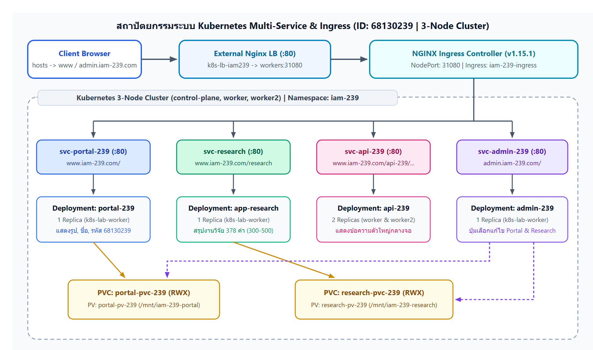

# Kubernetes Multi-Service & Ingress Project (ID: 68130239 | xxx = 239)

**ผู้จัดทำ:** Yutthasatr Khumkhonsue (รหัสนักศึกษา: `68130239`, รหัส 3 ตัวท้าย: `239`)  
**หลักสูตร:** วิศวกรรมศาสตรมหาบัณฑิต สาขาวิชาวิศวกรรมคอมพิวเตอร์ วิทยาลัยวิศวกรรมศาสตร์และเทคโนโลยี มหาวิทยาลัยธุรกิจบัณฑิตย์  
**โดเมนที่ให้บริการ:** `www.iam-239.com` และ `admin.iam-239.com`  
**Namespace:** `iam-239`  
**คลัสเตอร์ที่ใช้งาน:** Kubernetes จำนวน **3 Nodes** (`k8s-lab-control-plane`, `k8s-lab-worker`, `k8s-lab-worker2`)

---

## 1. สถาปัตยกรรมระบบ (Architecture)

ระบบรับทราฟฟิกจากเบราว์เซอร์ผ่านไฟล์ `hosts` เข้าสู่ **External Nginx Load Balancer** (`k8s-lb-iam239` พอร์ต `80`) แล้วกระจายไปยัง **NGINX Ingress Controller** (`NodePort: 31080`) ภายในคลัสเตอร์ Kubernetes 3 Nodes เพื่อจัดเส้นทางไปยัง Microservices ทั้ง 4 ตัวตาม Host และ URL Path พร้อมแยกจัดเก็บข้อมูลถาวรด้วย **PersistentVolumeClaim (PVC)** แบบ `ReadWriteMany` จำนวน 2 ชุด



### ตารางสรุปบริการทั้ง 4 Deployments

| URL / Host | Deployment | Service (`ClusterIP`) | Replicas / Node | Storage (PVC) & หน้าที่ |
| :--- | :--- | :--- | :--- | :--- |
| `http://www.iam-239.com/` | `portal-239` | `svc-portal-239:80` | `1` (`k8s-lab-worker`) | อ่านข้อมูลจาก `portal-pvc-239` แสดงรูปโปรไฟล์ ชื่อ และรหัสนักศึกษา `68130239` |
| `http://www.iam-239.com/research` | `app-research` | `svc-research:80` | `1` (`k8s-lab-worker`) | อ่านข้อมูลจาก `research-pvc-239` แสดงบทสรุปงานวิจัยวิชาสัมมนา (`378` คำ, อยู่ในช่วง `300–500` คำ) |
| `http://www.iam-239.com/api-239/<ข้อความ>` | `api-239` | `svc-api-239:80` | `2` (กระจาย `k8s-lab-worker`, `k8s-lab-worker2`) | นำข้อความต่อท้าย URL มาแสดงตัวอักษรขนาดใหญ่กลางหน้าจอ รองรับ UTF-8 / ภาษาไทย |
| `http://admin.iam-239.com/` | `admin-239` | `svc-admin-239:80` | `1` (`k8s-lab-worker`) | หน้าเมนูพร้อมปุ่มเลือกแก้ไขข้อมูลทั้ง `portal-239` (`/portal`) และ `app-research` (`/research`) บันทึกลง PVC |

---

## 2. โครงสร้างไฟล์ใน Repository

```text
Kubernetes-Multi-Service-Ingress-Project-/
├── apps/                        # ซอร์สโค้ด Python 3.11 (Mount เข้า Pod ผ่าน ConfigMap)
│   ├── portal-239/              # server.py, avatar.svg -> หน้า Portal (www.iam-239.com/)
│   ├── app-research/            # server.py -> หน้าสรุปงานวิจัย (/research)
│   ├── api-239/                 # server.py -> หน้าแสดงข้อความ (/api-239/<ข้อความ>)
│   └── admin-239/               # server.py, avatar.svg -> หน้าจัดการ Portal & Research (admin.iam-239.com)
├── k8s/                         # Kubernetes Manifests (Namespace: iam-239)
│   ├── 00-namespace.yaml        # Namespace: iam-239
│   ├── 01-storage.yaml          # 2x PV/PVC (portal-pv-239/portal-pvc-239 & research-pv-239/research-pvc-239)
│   ├── 02-portal-239.yaml       # Deployment: portal-239 + Service: svc-portal-239
│   ├── 03-app-research.yaml     # Deployment: app-research + Service: svc-research
│   ├── 04-api-239.yaml          # Deployment: api-239 (2 Replicas) + Service: svc-api-239
│   ├── 05-admin-239.yaml        # Deployment: admin-239 + Service: svc-admin-239
│   └── 06-ingress.yaml          # Ingress: iam-239-ingress (www.iam-239.com & admin.iam-239.com)
├── configs/
│   ├── etc-hosts-linux.txt      # ตัวอย่างการตั้งค่า /etc/hosts (Linux) และ hosts (Windows)
│   ├── k8s-lb-kind.conf         # คอนฟิก Nginx External LB สำหรับ Local Kind 3-Node
│   └── k8s-lb-ingress.conf      # คอนฟิก Nginx External LB สำหรับ VMware / Linux (192.168.1.20)
├── assets/
│   └── architecture.png         # ภาพแผนภาพสถาปัตยกรรมระบบ 3-Node Kubernetes Cluster
└── scripts/
    ├── deploy.bat               # Batch Script สำหรับ Deploy จาก Windows ลง kind-k8s-lab อัตโนมัติ
    ├── deploy.sh                # Shell Script สำหรับ Deploy บน Linux (Control Plane)
    ├── verify-local.ps1         # PowerShell Script ตรวจสอบสถานะ K8s, LB และทดสอบ HTTP บน Windows
    ├── verify.sh                # Shell Script ตรวจสอบสถานะ K8s และทดสอบ HTTP บน Linux
    ├── win-setup-hosts.bat      # สคริปต์เพิ่มโดเมนลงไฟล์ hosts ของ Windows อัตโนมัติ
    └── node-prereq.sh           # สคริปต์เตรียมเครื่อง Ubuntu 24.04 (containerd + kubeadm)
```

### ลิงก์ไฟล์สำคัญใน Repository
- **Manifests:** [00-namespace.yaml](./k8s/00-namespace.yaml) | [01-storage.yaml](./k8s/01-storage.yaml) | [02-portal-239.yaml](./k8s/02-portal-239.yaml) | [03-app-research.yaml](./k8s/03-app-research.yaml) | [04-api-239.yaml](./k8s/04-api-239.yaml) | [05-admin-239.yaml](./k8s/05-admin-239.yaml) | [06-ingress.yaml](./k8s/06-ingress.yaml)
- **Configs:** [etc-hosts-linux.txt](./configs/etc-hosts-linux.txt) | [k8s-lb-kind.conf](./configs/k8s-lb-kind.conf) | [k8s-lb-ingress.conf](./configs/k8s-lb-ingress.conf)
- **Scripts:** [deploy.bat](./scripts/deploy.bat) | [deploy.sh](./scripts/deploy.sh) | [verify-local.ps1](./scripts/verify-local.ps1) | [verify.sh](./scripts/verify.sh) | [win-setup-hosts.bat](./scripts/win-setup-hosts.bat)

---

## 3. ขั้นตอนการ Deploy ตั้งแต่ต้นจนใช้งานได้

### ข้อกำหนดเบื้องต้น (Prerequisites)
- **กรณีรันบน Windows (Local Kind):** มี Docker Desktop, `kubectl` และคลัสเตอร์ Kind 3 Nodes ชื่อ `kind-k8s-lab` (`k8s-lab-control-plane`, `k8s-lab-worker`, `k8s-lab-worker2`) พร้อมใช้งาน และพอร์ต `80` บนเครื่องว่างอยู่
- **กรณีรันบน Linux / VMware 3+1 Nodes:** เตรียม 4 เครื่อง (`k8s-control`, `k8s-worker1`, `k8s-worker2`, `k8s-lb`) ด้วย [scripts/node-prereq.sh](./scripts/node-prereq.sh), [configs/k8s-lb-ingress.conf](./configs/k8s-lb-ingress.conf) และ [configs/etc-hosts-linux.txt](./configs/etc-hosts-linux.txt)

---

### วิธีที่ A: Deploy อัตโนมัติบน Windows (`kind-k8s-lab` 3 Nodes) — แนะนำ

1. **ตั้งค่า Windows `hosts`:** คลิกขวาที่ [scripts/win-setup-hosts.bat](./scripts/win-setup-hosts.bat) -> เลือก **Run as administrator** เพื่อเพิ่มรายการใน `C:\Windows\System32\drivers\etc\hosts`:
   ```text
   127.0.0.1 www.iam-239.com admin.iam-239.com
   ```
2. **รันสคริปต์ Deploy อัตโนมัติ:** เปิด PowerShell หรือ CMD ในโฟลเดอร์โปรเจกต์แล้วรัน:
   ```cmd
   scripts\deploy.bat
   ```
   > **การทำงานของ [scripts/deploy.bat](./scripts/deploy.bat):**
   > 1. ตรวจสอบการเชื่อมต่อคลัสเตอร์ `--context kind-k8s-lab`
   > 2. ติดตั้ง NGINX Ingress Controller (`v1.15.1` Bare-metal) และตั้ง HTTP NodePort เป็น `31080`
   > 3. Apply `00-namespace.yaml` และ `01-storage.yaml` (สร้าง Namespace `iam-239` และ PV/PVC ทั้ง 2 ชุด)
   > 4. แพ็กซอร์สโค้ดจาก `apps/` เข้า ConfigMaps ทั้ง 4 ชุด (`portal-239-code`, `app-research-code`, `api-239-code`, `admin-239-code`)
   > 5. Apply `02`–`06` และรอ Pods ของทุก Deployment ขึ้น `Running`
   > 6. เปิดคอนเทนเนอร์ Nginx External LB ชื่อ `k8s-lb-iam239` พอร์ต `80` โดย mount [configs/k8s-lb-kind.conf](./configs/k8s-lb-kind.conf) ไปที่ `/etc/nginx/conf.d/iam-239-ingress.conf`
3. **ตรวจสอบความพร้อมทั้งระบบ:**
   ```powershell
   powershell -ExecutionPolicy Bypass -File scripts\verify-local.ps1
   ```

---

### วิธีที่ B: Deploy บน Linux / VMware 3+1 Nodes (`k8s-control` + `k8s-lb`)

1. บน **Control Plane (`k8s-control`)**: ปรับ `nodeSelector` ใน [k8s/02-portal-239.yaml](./k8s/02-portal-239.yaml), [k8s/03-app-research.yaml](./k8s/03-app-research.yaml) และ [k8s/05-admin-239.yaml](./k8s/05-admin-239.yaml) ให้ตรงกับชื่อ Worker Node (เช่น `k8s-worker1`) จากนั้นรัน:
   ```bash
   chmod +x scripts/*.sh
   bash scripts/deploy.sh
   ```
2. บนเครื่อง **External Load Balancer (`k8s-lb` : `192.168.1.20`)**: คัดลอกคอนฟิกจาก [configs/k8s-lb-ingress.conf](./configs/k8s-lb-ingress.conf) ไปวางที่ `/etc/nginx/conf.d/iam-239-ingress.conf` แล้วตรวจสอบและรีโหลด Nginx:
   ```bash
   sudo nginx -t && sudo systemctl reload nginx
   ```
3. บนเครื่อง **Client**: เพิ่มบรรทัดต่อไปนี้ใน `/etc/hosts` (ดูตัวอย่างใน [configs/etc-hosts-linux.txt](./configs/etc-hosts-linux.txt)) แล้วรัน `bash scripts/verify.sh`:
   ```text
   192.168.1.20 www.iam-239.com admin.iam-239.com
   ```

---

### วิธีที่ C: สรุปคำสั่ง `kubectl` แบบ Manual ทีละขั้นตอน

```bash
# 1. ติดตั้ง NGINX Ingress Controller (Bare-metal v1.15.1) และรอ Admission Webhook พร้อม
kubectl --context kind-k8s-lab apply -f https://raw.githubusercontent.com/kubernetes/ingress-nginx/controller-v1.15.1/deploy/static/provider/baremetal/deploy.yaml
kubectl --context kind-k8s-lab wait --namespace ingress-nginx --for=condition=complete job/ingress-nginx-admission-create --timeout=120s
kubectl --context kind-k8s-lab wait --namespace ingress-nginx --for=condition=complete job/ingress-nginx-admission-patch --timeout=120s
kubectl --context kind-k8s-lab wait --namespace ingress-nginx --for=condition=ready pod --selector=app.kubernetes.io/component=controller --timeout=180s

# 2. ตั้งค่า NodePort ของ Ingress Controller เป็น 31080
kubectl --context kind-k8s-lab patch svc ingress-nginx-controller -n ingress-nginx -p "spec: {ports: [{port: 80, nodePort: 31080}]}"

# 3. สร้าง Namespace และ PV/PVC ทั้ง 2 ชุด
kubectl --context kind-k8s-lab apply -f k8s/00-namespace.yaml -f k8s/01-storage.yaml

# 4. สร้าง ConfigMaps จากโค้ดใน apps/
kubectl --context kind-k8s-lab create configmap portal-239-code --from-file=apps/portal-239 -n iam-239 --dry-run=client -o yaml | kubectl --context kind-k8s-lab apply -f -
kubectl --context kind-k8s-lab create configmap app-research-code --from-file=apps/app-research/server.py -n iam-239 --dry-run=client -o yaml | kubectl --context kind-k8s-lab apply -f -
kubectl --context kind-k8s-lab create configmap api-239-code --from-file=apps/api-239/server.py -n iam-239 --dry-run=client -o yaml | kubectl --context kind-k8s-lab apply -f -
kubectl --context kind-k8s-lab create configmap admin-239-code --from-file=apps/admin-239 -n iam-239 --dry-run=client -o yaml | kubectl --context kind-k8s-lab apply -f -

# 5. Deploy ทั้ง 4 Services และ Ingress
kubectl --context kind-k8s-lab apply -f k8s/02-portal-239.yaml -f k8s/03-app-research.yaml -f k8s/04-api-239.yaml -f k8s/05-admin-239.yaml -f k8s/06-ingress.yaml

# 6. รอจน Pods ทุก Deployment พร้อมใช้งาน
kubectl --context kind-k8s-lab rollout status deployment/portal-239 deployment/app-research deployment/api-239 deployment/admin-239 -n iam-239 --timeout=180s
```

---

## 4. การตรวจสอบระบบและ URL สำหรับทดสอบ

### คำสั่งตรวจสอบสถานะ Kubernetes และ Nginx LB
```bash
# ตรวจสอบสถานะ Node ทั้ง 3 เครื่อง
kubectl --context kind-k8s-lab get nodes -o wide

# ตรวจสอบ Pods, Services, Ingress, PV, PVC, ConfigMaps และ Endpoints ใน Namespace iam-239
kubectl --context kind-k8s-lab get all,ingress,pv,pvc,cm,endpoints -n iam-239 -o wide

# ตรวจสอบรายละเอียด Routing Rules ของ Ingress และสถานะการ Mount PVC
kubectl --context kind-k8s-lab describe ingress iam-239-ingress -n iam-239
kubectl --context kind-k8s-lab describe pvc portal-pvc-239 research-pvc-239 -n iam-239

# ตรวจสอบคอนฟิก Nginx บนคอนเทนเนอร์ External LB
docker exec k8s-lb-iam239 cat /etc/nginx/conf.d/iam-239-ingress.conf
```

### URL สำหรับเปิดทดสอบบนเบราว์เซอร์
1. **Portal แสดงรูป ชื่อ และ ID (`portal-239`):** `http://www.iam-239.com/`
2. **สรุปงานวิจัย 300–500 คำ (`app-research`):** `http://www.iam-239.com/research`
3. **API แสดงข้อความตัวใหญ่กลางจอ (`api-239`):**
   - ภาษาอังกฤษ: `http://www.iam-239.com/api-239/Hello%2068130239`
   - ภาษาไทย: `http://www.iam-239.com/api-239/ทดสอบระบบ`
4. **Admin หน้าปุ่มเลือกแก้ไข Portal และ Research (`admin-239`):** `http://admin.iam-239.com/`
   - หน้าแก้ไข Portal (ข้อความ + อัปโหลดรูปโปรไฟล์): `http://admin.iam-239.com/portal`
   - หน้าแก้ไขบทสรุปงานวิจัย (พร้อมตัวนับคำ): `http://admin.iam-239.com/research`


